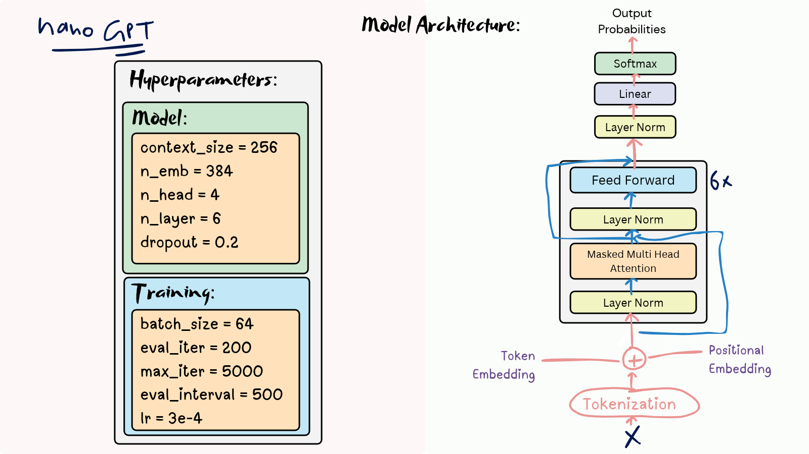
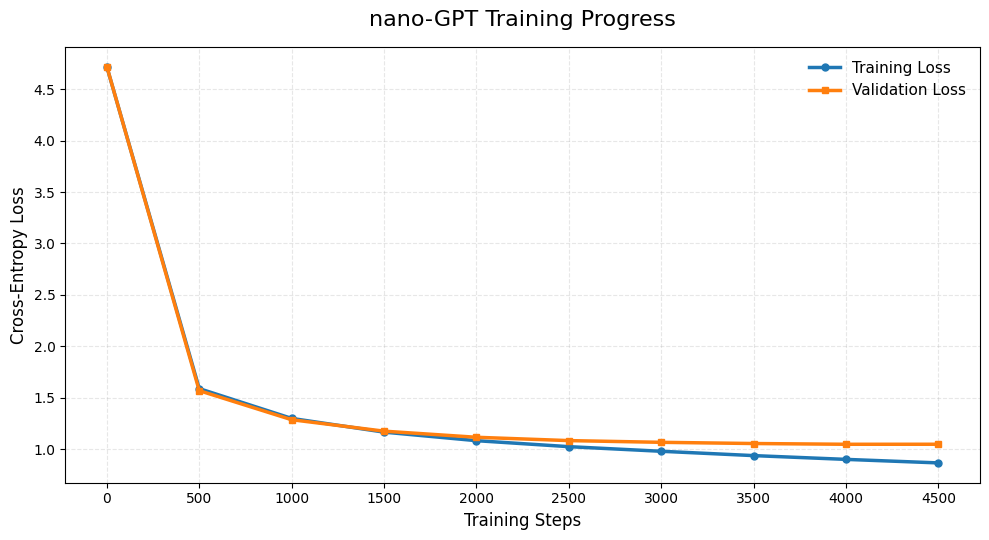

## nano GPT:

nano GPT is a decoder only transformer.
I trained model on  `ramayana_text.txt` (923k chars). model code is in `model.py`.
training code is in `train.py`. Run `sample.py` to see sample prediction of this transformer. 
i saved model state_dict in `nano_gpt.pth` and tokenizer into `tokenizer.json` so i can easily reproduce samples without again training. 



##  Loss Curve



out context_size is 256 and the batch size 64 and max_iter 5000. by these big numbers it generating little good text not fully meaningfull but that's so much till now without any fine tuning the intialization is just stay with karpathy hyperparameter. i will tune it but on kaggle notebook it took about 20 second :p 25 minutes. we will do fine tunign later

Generated sample like this:
```
guised  his  Life,  Sita;  he  learned  and  said  to  Rama’s  way and  let  ho  kill  him  that  she  had  fought  of  his  hard  eyes. Kashyapa  knew  the  giant  carnage  could  not  capture  over  the altar.  He  struck  on  its  head  over,  through  the  confine  gloom and  raises  whi?  There  was  not  soung.  For  the  clear  from  his palace  where  they  cannot  the  shrink  of  Shiva  had  not  energy.
```